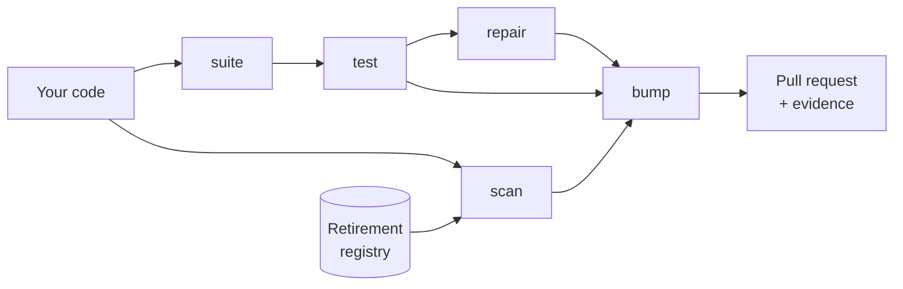

# How it works

ModelBump is a pipeline of steps. Each step reads a file and writes one, so you can stop after any step, read its output, and go on later.

## Scan: which models does the code use?

`modelbump scan` reads every code and config file and finds model IDs such as `gpt-4o-mini` or `claude-3-haiku-20240307`, including Bedrock and Vertex AI forms. It checks each one against a registry of retirement dates taken from the providers' own deprecation pages. The result says how urgent each model is (`RETIRED`, `RETIRING_SOON`, `DEPRECATED`, `UNKNOWN`), and where the ID sits: a call argument, a variable, a config value, a comment.

On 100 real projects, each at the commit just before it moved off a retired model, the scanner found 97.7% of the lines that named the old model. [Details](../research/scanner-eval.md).

## Suite: what does the app ask the model?

`modelbump suite` finds the LLM calls in your Python code and reads their prompts, following variables, functions and imports. Inputs come from places where your code or tests call the function with real values. When there are none, `--generate` has a local model write them. Each case gets a check that fits the answer:

- **JSON:** the same keys and types as the old model gave;
- **label:** the same label from a fixed list;
- **tools:** the same tool call;
- **free text:** a judge model decides whether the answer still does the job, against an old answer as reference.

The judge was checked against blind hand labels: 87% of its PASSes and 68% of its FAILs were right. [Details](../research/suites.md).

## Test: is the new model worse, or is it randomness?

The same prompt gives different answers each time, so one run per model proves little. `modelbump test` asks each model several times per case. A statistics engine then decides each case as REGRESSED, EQUIVALENT, IMPROVED or INCONCLUSIVE, and controls false alarms across the whole suite. On real answers from one model compared with itself, a plain one-run diff flagged 2.6 of 60 unchanged cases as worse; the suite methods flagged almost none. [Details](../research/stats-real.md).

## Repair: can a prompt fix bring it back?

Often the fix is a sentence in the prompt. `modelbump repair propose` shows the failing answers to a model and asks for small edits. `modelbump repair run` accepts an edit only if fresh answers show every case of that call is no worse than the old model, so a fix cannot quietly break another input. On 6 real regressions it repaired 2. A plain "rewrite this prompt" baseline repaired none. [Details](../research/repair.md).

## Bump: the change, with its evidence

`modelbump bump` changes the model ID only at the places the scanner found in code. Comments, price tables and platform-specific forms are listed for you instead. Accepted repairs are written into the prompt strings when their place is certain. The test files are added to `.modelbump/`, with secrets and email addresses redacted. The pull request description is the evidence report: why, what changed, what to check, and every verdict.

`modelbump bump-all` does this for every due model, one pull request each. The [GitHub Action](action.md) runs it on a schedule, like Dependabot.

## What ModelBump does not do

- It does not call your production models in CI. You run the test where you choose, with the models you choose, and attach the result.
- It cannot tell that an app works, only that it does no worse on the cases it has. Few cases mean weak evidence, and the report says how many there were.
- Prompt reading and repair cover Python. The scanner covers Python, JavaScript, TypeScript, other languages and config files.
- Merging is yours. Every pull request asks a person to review it.

The reasoning behind each choice is in the [decision records](../adr/index.md).
